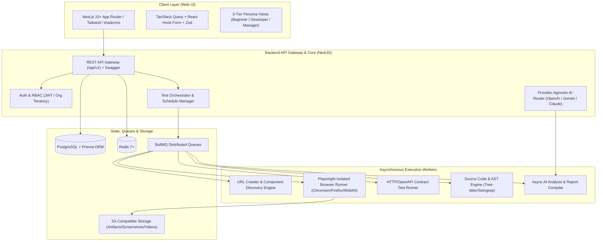
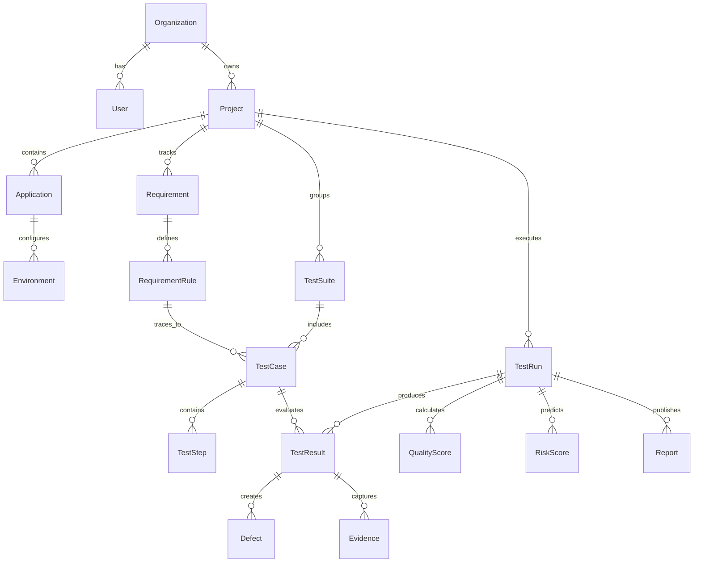

# QualityPilot AI — Production Architecture & Implementation Blueprint

> **Product Tagline:**  
> *“From Requirement to Release — AI-Powered Software Quality Engineering and Release Assurance.”*

---

## 1. Executive Summary & Core Engineering Philosophy

**QualityPilot AI** is an enterprise-grade Software Quality Engineering and Release Assurance platform designed around an uncompromising principle: **The Absolute Separation of Deterministic Fact and AI Reasoning**.

### The Non-Negotiable Source-of-Truth Hierarchy
```
┌────────────────────────────────────────────────────────┐
│               DETERMINISTIC ENGINES                   │
│  Playwright (Browser)  •  OpenAPI/HTTP (API)           │
│  Tree-sitter/Semgrep (Code)  •  Axe-Core (A11y)        │
│  Core Web Vitals (Perf)  •  PostgreSQL (Metrics Engine)│
└──────────────────────────┬─────────────────────────────┘
                           │ Raw Facts (Pass/Fail, Latency,
                           │ Elements, Violations, Metrics)
                           ▼
┌────────────────────────────────────────────────────────┐
│             AI REASONING & SYNTHESIS LAYER             │
│  Hypothesis Generation  •  Root Cause Analysis         │
│  Risk Correlation  •  Safe Code Improvement Ideas       │
│  Triaged Reporting across Beginner/Dev/Manager views   │
└────────────────────────────────────────────────────────┘
```

1. **Test Engine & Browser:** Absolute authority on whether tests passed, failed, or were blocked.
2. **Metrics Engine:** Absolute authority on scores, execution counts, response timings, and coverage metrics.
3. **Static/Security Analyzers:** Absolute authority on AST findings, vulnerabilities, and syntax metrics.
4. **AI Layer:** Responsible strictly for **synthesis, hypothesis, natural-language explanation, exploratory ideation, and guided remediation suggestions** — and **NEVER** for fabricating test counts, pass rates, or simulated metrics.

---

## 2. High-Level System Architecture



---

## 3. Two Operational Modes: Black-Box vs White-Box

| Dimension | Mode A: URL-Only Black-Box Testing | Mode B: Source-Code Intelligence (White-Box) |
| :--- | :--- | :--- |
| **Input Required** | Target URL, optional credentials, optional high-level requirements | Git repository (GitHub/GitLab/Bitbucket), zip archive, or direct source access |
| **Discovery** | Headless browser DOM traversal, network sniffer, form field extraction | AST parsing, route detection, controller inspection, DB schema analysis |
| **Testing Scope** | Functional UI, validation boundaries, accessibility, CWV performance, visual diffs | Code-level test generation, unit/integration traceability, regression impact analysis |
| **Root Cause Attribution** | "Observed runtime behavior: validation error not triggered on submission" | "Code-level hypothesis: `src/auth/validator.ts` line 42 lacks regex for special chars" |
| **Truth Boundary** | Explicitly labels findings as *Runtime Observation*; forbids claiming internal code faults | Correlates runtime failures directly to AST nodes, commits, and PR diffs |

---

## 4. Complete Relational Database Schema (Prisma ERD)



### Core Entity Responsibilities
1. **Multi-Tenancy (`Organization`, `User`, `Project`):** Strict workspace isolation with Organization-level RBAC (`OWNER`, `ADMIN`, `MEMBER`, `VIEWER`).
2. **Requirements & Traceability (`Requirement`, `RequirementRule`, `TestCase`):** Maps natural language rules to concrete deterministic test cases with coverage metrics.
3. **Execution & Evidence (`TestRun`, `TestResult`, `Evidence`):** Stores logs, DOM snapshots, network HAR recordings, video/screenshot URIs, and status timestamps.
4. **Intelligence & Quality Twin (`QualityScore`, `RiskScore`, `Defect`, `Report`):** Calculates multi-dimensional quality index scores (0–100) and release recommendations (`APPROVED`, `APPROVED_WITH_WARNINGS`, `REQUIRES_FIXES`, `BLOCKED`).

---

## 5. Provider-Agnostic AI Layer Architecture

```
                       ┌──────────────────────┐
                       │  AI Provider Router  │
                       └──────────┬───────────┘
                                  │
          ┌───────────────────────┼───────────────────────┐
          ▼                       ▼                       ▼
┌──────────────────┐    ┌──────────────────┐    ┌──────────────────┐
│ OpenAI Provider  │    │ Gemini Provider  │    │ Claude Provider  │
│ (gpt-4o, o3-mini)│    │ (gemini-2.5-*)   │    │ (claude-3-5-*)   │
└──────────────────┘    └──────────────────┘    └──────────────────┘
```

- **Interface Contract (`IAIProvider`):** Standardizes `analyzeRequirements()`, `generateTestMatrix()`, `analyzeFailure()`, `generateRecommendations()`, and `summarizeReport()`.
- **Zod Validation Safeguard:** All structured AI responses are parsed through strict Zod schemas with fallback recovery to eliminate schema deviations.
- **Privacy & Scrubbing:** Automatic redaction of secrets, authorization tokens, passwords, and sensitive PII prior to upstream transmission.

---

## 6. Monorepo Structure

```
qualitypilot-ai/
├── apps/
│   ├── web/                    # Next.js 15+ App Router, Tailwind, shadcn/ui
│   │   ├── src/app/            # App routes (Dashboard, Testing, Reports, Settings)
│   │   ├── src/components/     # UI Component system (Beginner/Dev/Manager views)
│   │   └── src/lib/            # Client API bindings, TanStack query hooks
│   └── api/                    # NestJS Core Backend
│       ├── src/modules/
│       │   ├── auth/           # RBAC, JWT, sessions
│       │   ├── organizations/  # Multi-tenant management
│       │   ├── projects/       # Projects, apps & environments
│       │   ├── requirements/   # Requirement intelligence & ambiguity detector
│       │   ├── testing/        # Test runner & Playwright orchestrator
│       │   ├── ai/             # AI provider abstraction layer
│       │   ├── defects/        # Defect tracking & fix verifier
│       │   ├── reports/        # Master report generator (HTML/PDF/JSON)
│       │   └── health/         # System & AI provider health
│       └── src/common/         # Guards, interceptors, filters, encryption
├── packages/
│   ├── database/               # Prisma schema, migrations, seeders
│   ├── types/                  # Shared TypeScript models & Zod schemas
│   └── ai-engine/              # Shared AI provider router & prompts
├── docker/
│   └── docker-compose.yml      # Postgres, Redis, MinIO (local dev)
├── .env.example
├── package.json
└── README.md
```

---

## 7. Phased Implementation Roadmap

* **Phase 1: Foundation & Project Workspace (NOW)**
  * Monorepo setup (npm/pnpm workspaces)
  * Shared types & Zod contracts
  * Database schema (Prisma + PostgreSQL)
  * Backend API scaffolding (NestJS: Auth, Users, Orgs, Projects, Health)
  * Secure encryption & `.env.example` setup
  * Frontend dashboard foundation (Next.js + Tailwind + shadcn/ui + Navigation)
* **Phase 2:** URL Discovery Engine & Playwright Browser Automation Runner
* **Phase 3:** Functional Test Execution & Multi-Modal Evidence Collection
* **Phase 4:** Requirement Intelligence & Provider-Agnostic AI Test Case Generator
* **Phase 5:** Login Matrix & Validation Boundary Intelligence
* **Phase 6:** AI Failure Analysis, Defect Engine & Fixed-Schema Master Reports
* **Phase 7–14:** White-Box, Code Traceability, API/DB, Visual Regression, Digital Quality Twin & CI/CD
